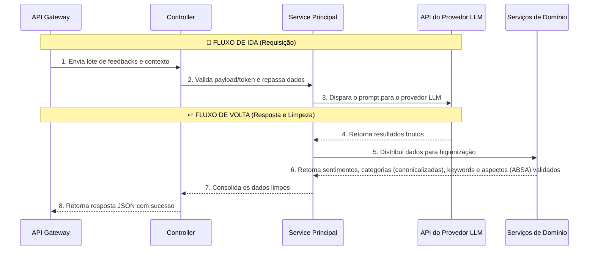

# IA Analyze — Arquitetura e Estrutura

Este documento detalha a arquitetura do serviço Serverless de IA (`ia-analyze`). Diferente do API Gateway, este serviço não possui conexão com o banco de dados. Sua única responsabilidade é processar textos de forma isolada, recebendo dados brutos e retornando análises estruturadas.

> Este é o **repositório próprio** do serviço (`feedback-analytics-ia-analyze`) — a raiz é o próprio serviço. Os contratos vêm do pacote [`@feedback/lib-shared`](https://github.com/TCC-Feedback-Analytics/feedback-analytics-contracts); concepção e produto ficam no [repositório central de documentação](https://github.com/TCC-Feedback-Analytics/feedback-analytics).

## O Fluxo de Dados (Ida e Volta)

O processamento ocorre de forma sequencial através das camadas do sistema, garantindo que os dados sejam validados, enviados para a IA e rigorosamente sanitizados antes de retornarem.

### Fluxo de Ida (Recebendo a requisição)
1. **Rotas (`routes/`):** Recebem o lote de feedbacks enviado pelo API Gateway e direcionam para o controlador.
2. **Controllers (`controllers/`):** Validam a autorização interna (garantindo que a requisição veio do Gateway) e a estrutura do payload recebido.
3. **Service Principal (`services/iaAnalyze.service.ts`):** Orquestra o processo. Combina os feedbacks com as regras e o contexto de negócio da empresa.
4. **Providers (`providers/`):** Uma **fábrica** (`createProvider.ts`) devolve o adaptador do provedor escolhido — **Gemini** (`gemini.provider.ts`, SDK `@google/genai`) ou **OpenRouter** (`openrouter.provider.ts`, API compatível com OpenAI). Ambos implementam a mesma **porta** `IaApiClient` (padrão Strategy/Adapter), preparam o prompt final e chamam a API do LLM com a instrução de sistema de pt-BR (`lib/prompts/ptBrSystemInstruction.ts`). O motor **não sabe** qual provedor está atrás — o provedor vem na requisição, não no código.

### Fluxo de Volta (Processando a resposta)
5. O **Provider** recebe a resposta bruta da Inteligência Artificial (que está sujeita a "alucinações" ou fuga do formato) e a converte em JSON.
6. O **Service Principal** valida o lote antes de usar: formato e cobertura exata dos IDs (`validations/iaBatchResponse.validation.ts`) e idioma do resumo e das recomendações (`validations/ptBrLanguage.validation.ts`). Texto fora do pt-BR ganha **uma** nova tentativa com o reforço de idioma no prompt; os detalhes estão em [Validação das respostas de IA](validacao-respostas-ia.md).
7. Com o lote válido, o **Service Principal** distribui os dados para seus **Serviços de Domínio** especializados:
   - **Análise de Sentimento:** Valida se a classificação está estritamente entre Positivo, Neutro ou Negativo.
   - **Palavras-chave e Categorias:** Sanitiza os termos extraídos, garantindo que eles realmente existam no texto original do cliente. As categorias ainda são **canonicalizadas** contra a taxonomia fixa do escopo (`categorization.service` passou a receber `scopeType`), tornando-as comparáveis e tendenciáveis.
   - **Aspectos (ABSA):** Extrai os aspectos com sentimento por tópico (`aspectExtraction.service`), também ancorados no texto original. Além disso, o Service Principal grava o `sentiment_score` graduado (com fallback derivado da classe de sentimento) e a `confidence` de cada item.
   - **Contexto Global:** Monta o contexto do lote (escopo, item, quantidade analisada) com os insights que o modelo devolveu para ele.
8. O **Service Principal** agrupa todas essas validações num pacote limpo e seguro, repassando ao **Controller**.
9. O **Controller** entrega a resposta final (em formato JSON padronizado) de volta ao API Gateway.

As outras rotas seguem o mesmo caminho (rota → controller → service → provider), cada uma com seu service e seu prompt — ver [Outras tarefas de IA](#outras-tarefas-de-ia).

---

## O Fluxo Visual



---

## `termProcessing.ts` — Núcleo de Sanitização

Este módulo é o coração do processamento linguístico. Filtra termos que o modelo possa ter "alucinado", descartando os que não aparecem no feedback original.

### `sanitizeTermList`

```typescript
sanitizeTermList({
  terms: string[],            // lista bruta do modelo (keywords ou categorias)
  messageNormalized: string,  // mensagem do feedback normalizada
  forbiddenTerms: Set<string>,// termos que não devem aparecer
  maxCount: number,           // limite de termos no resultado
}) → string[]
```

Garante que cada termo:
1. É uma string não-vazia
2. Aparece de alguma forma na mensagem original (filtra alucinações)
3. Não está na lista de termos proibidos
4. Não é duplicata

### `buildForbiddenTerms`

Constrói o `Set` de termos proibidos a partir do feedback:
- Rótulos genéricos de respostas estruturadas (`STRUCTURED_ANSWER_LABELS`: `pessimo`, `ruim`, `mediana`, `boa`, `otima`)
- `answer_value` e `question_text_snapshot` de cada resposta dinâmica (`dynamic_answers`)
- `answer_value` e `subquestion_text_snapshot` de cada subresposta dinâmica (`dynamic_subanswers`)

### `tokenizeRelevantWords`

Quebra uma string em palavras relevantes removendo stop words e palavras com menos de 4 caracteres. Usado como **fallback de keywords** quando o modelo não retorna nenhuma keyword válida.

---

## `categoryTaxonomy.ts` — Taxonomia fixa por escopo

Torna as categorias **comparáveis e tendenciáveis**: a saída livre do modelo é mapeada para um rótulo canônico quando bate com o canônico ou um sinônimo; quando não bate, o termo é mantido como **emergente** (sem perda de sinal). Os rótulos canônicos seguem o estilo do saneamento (`normalizeForComparison`: minúsculas, sem acento), para casar na deduplicação.

- **`TAXONOMY_BY_SCOPE`:** tabela fixa de categorias (drivers de CX) por escopo `COMPANY` / `PRODUCT` / `SERVICE` / `DEPARTMENT`, cada nó com um `canonical` e seus `synonyms`. Semeada a partir das listas de `prompts/scopeInstructions.ts`.
- **`canonicalizeCategories(scope, categories)`:** mapeia cada categoria já saneada para a taxonomia — match exato (canônico/sinônimo) → canônico; senão, se algum **token** da categoria for chave → canônico; senão, mantém o termo como emergente (normalizado). Deduplica preservando a ordem.
- **`getTaxonomyLabels(scope)`:** retorna os rótulos canônicos do escopo, usados como **nudge** no prompt.

O `categorization.service` agora recebe `scopeType` e chama `canonicalizeCategories` sobre a lista saneada (ou sobre o fallback de keywords, quando vazia).

---

## `aspectExtraction.service.ts` — Aspectos (ABSA)

Extrai aspectos (Aspect-Based Sentiment Analysis) do que o modelo devolveu, reusando o mesmo saneamento de categorias/keywords.

- **`extractAspects(feedback, rawAspects)`:** cada rótulo precisa estar **ancorado no `message`**, não pode ser termo proibido (rótulos de pergunta/Likert), é **deduplicado** e limitado a no máximo **6** aspectos. Cada aspecto preserva seu `sentiment` (validado entre Positivo/Neutro/Negativo) e seu `sentiment_score` (com `clamp` em `[-1, 1]`). Retorna `[]` quando `rawAspects` não é um array.
- **Helpers:** `clampScore` (limita ao intervalo `[-1, 1]`; `undefined` se não for número válido), `normalizeConfidence` (limita a `[0, 1]`) e `scoreFromSentiment` (score padrão a partir da classe quando o modelo omite: `+0.6` / `0` / `-0.6`).

---

## Resiliência do Orquestrador (`iaAnalyze.service.ts`)

Como os lotes passaram a ser fatiados por tamanho no gateway, o número de chamadas ao LLM cresce. O orquestrador foi endurecido em duas frentes:

- **Concorrência limitada:** `mapWithConcurrency` (semáforo simples que preserva a ordem dos resultados) substitui o `Promise.all` sem limite. O teto de chamadas em voo vem de `IA_LLM_CONCURRENCY` (default **3**; aceita o nome antigo `IA_GEMINI_CONCURRENCY`), evitando estourar o rate limit do provedor.
- **Conclusão integral:** a requisição só dá certo se **todos** os lotes com conteúdo concluírem. No primeiro lote que falha, o orquestrador para de agendar os próximos, aguarda as chamadas já em voo, registra no log os códigos de falha e responde `502` — com `incomplete_ai_response` se algum lote chegou a concluir, ou com o código da primeira falha (`failed_ia_request` quando não há código tipado). Não há sucesso parcial; ver [Validação das respostas de IA](validacao-respostas-ia.md#conclusão-integral).

---

## Resiliência dos Providers (`providers/shared/retry.ts`)

O retry/erro é **compartilhado** pelos dois adaptadores (Gemini e OpenRouter) num único módulo; o que é específico de cada provedor — o que conta como transitório e o delay sugerido — entra por parâmetro em `runWithRetry`.

- **Retry/backoff exponencial com jitter:** até `MAX_ATTEMPTS = 4` tentativas para falhas transitórias (status `429`, `500`, `502`, `503`, `504`). O atraso é exponencial com jitter (limitado a 20s) e **honra o delay sugerido** pelo provedor quando presente — o `retryDelay` do Gemini ou o header `Retry-After` do OpenRouter. Cada provedor decide o que **não** retentar: no Gemini, a **cota diária** esgotada falha rápido (retentar só queima mais cota); no OpenRouter, `401` (chave inválida) e `402` (sem créditos) não são retentados.
- **Teto de saída:** `maxOutputTokens` / `max_tokens = 16384` por chamada — folgado, abaixo do máximo do modelo, servindo de trava já que os lotes vêm fatiados por tamanho. Exceção: no Gemini, a geração de perguntas usa `1024`.
- **Geração de perguntas:** não tem retry e tem timeout de 60 s nos dois adaptadores.
- **Saída truncada:** quando a saída é cortada por limite de tokens (Gemini `finishReason = MAX_TOKENS`; OpenRouter `finish_reason = 'length'`), o JSON está incompleto; o provider **não tenta parsear** e lança `invalid_ai_response` (Gemini) ou `truncated_ai_response` (OpenRouter).

---

## Outras tarefas de IA

Além da análise de lotes, o serviço tem três tarefas, cada uma com rota, service, prompt e validação próprios. Payloads e respostas em [Endpoints](endpoints.md).

- **Síntese de insights** (`synthesize-insights`): `runIaInsightsSynthesisService`, no `iaAnalyze.service.ts`, faz o reduce final. Recebe só os insights parciais dos lotes, nunca os feedbacks crus (`validations/insightsSynthesisRequest.validation.ts` aceita até 100), monta o prompt em `lib/insightsSynthesisPromptBuilder.ts` e valida a saída (`validations/insightsSynthesis.validation.ts`: resumo e de 1 a 8 recomendações). Texto fora do pt-BR ganha uma nova tentativa.
- **Diagnóstico do escopo** (`diagnose-scope`): `scopeDiagnosis.service.ts`. O Gateway manda os números já calculados do período e do anterior, o campo de comentário do escopo e uma amostra de comentários; a IA só interpreta. O prompt (`lib/scopeDiagnosisPrompt.ts`) traz as regras de leitura — confiança de cada número, participação nos comentários, pergunta própria do campo de comentário, canais de coleta (QR, link, NFC), comparação com o período anterior — e `validations/scopeDiagnosis.validation.ts` valida o pedido e a resposta. Texto fora do pt-BR ganha uma nova tentativa.
- **Sugestões de perguntas** (`generate-company-questions`): `companyQuestionSuggestions.service.ts`. Recebe só o contexto da empresa, pede ao modelo três perguntas na escala PÉSSIMO–ÓTIMA (`lib/companyQuestionSuggestionsPrompt.ts`) e valida o retorno (`validations/companyQuestionSuggestions.validation.ts`: exatamente três, distintas, de 20 a 150 caracteres, em pt-BR).

Diagnóstico e sugestões de perguntas **não usam o fallback legado** da seção abaixo: exigem provedor (`openrouter` ou `gemini`), chave e modelo da empresa nos headers `x-llm-*`; sem eles, respondem `409 ia_config_required`. Os dois controllers também respondem `503 internal_auth_not_configured` quando rodam na Vercel ou com `NODE_ENV=production` sem `IA_ANALYZE_INTERNAL_TOKEN`.

---

## Provedor de LLM Configurável / BYO-key (etapa 04)

O serviço deixou de ser preso ao Gemini. Duas peças novas, sem mexer no motor de análise:

- **Fábrica (`providers/createProvider.ts`):** recebe `{ provider, apiKey, model }` e devolve o adaptador certo (`openrouter` → OpenRouter; `gemini`, e qualquer outro valor, → Gemini), ambos por trás da porta `IaApiClient`. Adicionar um provedor novo é escrever mais um adaptador — o orquestrador não muda.
- **Adaptador OpenRouter (`providers/openrouter.provider.ts`):** fala a API compatível com OpenAI (`POST /chat/completions`), reusando o **mesmo** builder de prompt e parser de JSON do Gemini. Default de modelo: `openrouter/auto` (roteamento automático).

**De onde vêm provedor/chave/modelo na análise e na síntese** (`resolveProviderConfig` no `iaAnalyze.service.ts`), em ordem de prioridade, campo a campo:

1. **Por requisição (BYO-key):** headers `x-llm-provider` / `x-llm-api-key` / `x-llm-model`, enviados pelo API Gateway com a chave **decifrada** da empresa. O controller lê via `readLlmCreds(req)` e **nunca** loga esses headers (a chave é sensível).
2. **Fallback global legado:** o código ainda reconhece `LLM_PROVIDER` (default `gemini`), `GEMINI_API_KEY`/`OPENROUTER_API_KEY` e `LLM_MODEL` para compatibilidade, mas essas variáveis não fazem parte da configuração padrão (não estão no `.env.example`). O Gateway exige a chave OpenRouter por empresa.

O provedor resolvido vira `openrouter` só se o valor for `openrouter`; qualquer outro vira `gemini`. Se nenhum dos dois trouxer chave para o provedor escolhido, o serviço responde `500` `missing_gemini_api_key` / `missing_openrouter_api_key`. Diagnóstico do escopo e sugestões de perguntas não passam por aqui: usam só os headers (ver [Outras tarefas de IA](#outras-tarefas-de-ia)). Assim, a decisão "qual empresa usa qual chave" mora no **Gateway** (tabela cifrada `enterprise_ia_config`); o `ia-analyze` continua **stateless** — só recebe a credencial pronta e executa.

---

## Estrutura de Diretórios

```
feedback-analytics-ia-analyze/
├── src/
│   ├── index.ts                            → Entry point do servidor Express
│   ├── controllers/
│   │   └── iaAnalyze.controller.ts         → Token + payload + creds x-llm-* (BYO-key) + resposta HTTP
│   ├── services/
│   │   ├── iaAnalyze.service.ts            → Orquestrador da análise + síntese de insights
│   │   ├── sentimentAnalysis.service.ts    → Validação de sentimentos
│   │   ├── keywordExtraction.service.ts    → Extração com fallback
│   │   ├── categorization.service.ts       → Categorização com fallback + canonicalização por escopo
│   │   ├── aspectExtraction.service.ts     → Extração de aspectos (ABSA) ancorada no message
│   │   ├── globalInsights.service.ts       → Contexto por batch
│   │   ├── scopeDiagnosis.service.ts       → Diagnóstico do escopo
│   │   └── companyQuestionSuggestions.service.ts → Sugestões de perguntas da empresa
│   ├── providers/
│   │   ├── createProvider.ts               → Fábrica (Strategy): escolhe o adaptador por config
│   │   ├── gemini.provider.ts              → Adaptador Gemini (SDK @google/genai)
│   │   ├── openrouter.provider.ts          → Adaptador OpenRouter (API compatível com OpenAI)
│   │   └── shared/
│   │       └── retry.ts                    → Retry/backoff + IaApiClientError compartilhados
│   ├── routes/
│   │   └── iaAnalyze.routes.ts             → health + analyze, synthesize-insights, diagnose-scope, generate-company-questions (sob /internal)
│   ├── lib/
│   │   ├── iaAnalyzePromptBuilders.ts      → Prompt da análise por escopo (inclui a pergunta do comentário)
│   │   ├── insightsSynthesisPromptBuilder.ts → Prompt da síntese de insights
│   │   ├── scopeDiagnosisPrompt.ts         → Prompt do diagnóstico do escopo
│   │   ├── companyQuestionSuggestionsPrompt.ts → Prompt das sugestões de perguntas
│   │   ├── termProcessing.ts               → sanitize, forbidden terms, tokenize
│   │   ├── categoryTaxonomy.ts             → Taxonomia fixa por escopo + canonicalização
│   │   └── prompts/
│   │       ├── promptHeader.ts             → Cabeçalho base do prompt
│   │       ├── ptBrSystemInstruction.ts    → Instrução de sistema pt-BR + reforço de idioma
│   │       └── scopeInstructions.ts        → Instruções por escopo injetadas no prompt
│   ├── validations/
│   │   ├── iaAnalyze.validation.ts         → isValidRemotePayload
│   │   ├── iaBatchResponse.validation.ts   → Formato e cobertura dos IDs da resposta do lote
│   │   ├── ptBrLanguage.validation.ts      → Validação de idioma pt-BR
│   │   ├── insightsSynthesisRequest.validation.ts → Pedido da síntese
│   │   ├── insightsSynthesis.validation.ts → Resposta da síntese
│   │   ├── scopeDiagnosis.validation.ts    → Pedido e resposta do diagnóstico
│   │   └── companyQuestionSuggestions.validation.ts → Pedido e resposta das sugestões de perguntas
│   └── utils/
│       ├── extractJsonFromText.ts
│       ├── isInternalRequestAuthorized.ts
│       ├── isObject.ts
│       └── normalizeForComparison.ts
├── types/                                  → Tipos locais (fora de src/) que compõem/reexportam contratos de @feedback/lib-shared
│   ├── iaAnalyzeEngine.types.ts
│   ├── iaAnalyzePromptBuilders.types.ts
│   ├── iaApiClient.types.ts
│   ├── insightsSynthesis.types.ts
│   ├── sentimentAnalysis.types.ts
│   └── termProcessing.types.ts
└── src/tests/
    ├── lib/
    │   ├── termProcessing.test.ts
    │   ├── categoryTaxonomy.test.ts
    │   └── iaAnalyzePrompt.test.ts
    ├── routes/
    │   ├── analyze.test.ts
    │   ├── diagnoseScope.test.ts
    │   └── health.test.ts
    ├── providers/
    │   ├── gemini.provider.test.ts
    │   └── openrouter.provider.test.ts
    ├── services/
    │   ├── sentiment.test.ts
    │   ├── aspectExtraction.test.ts
    │   ├── iaAnalyzeCompletion.test.ts
    │   └── scopeDiagnosis.test.ts
    └── validations/
        └── ptBrLanguage.test.ts
```
